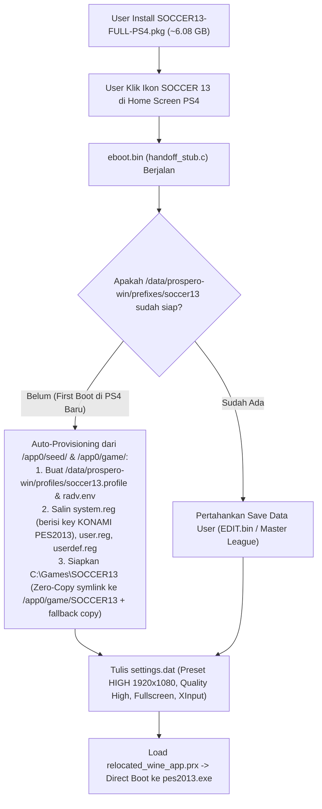

# Implementation Plan: Dump Game dari PS4 & Pembuatan Standalone PKG (`SOCCER13-FULL-PS4.pkg`)

## 1. Tujuan
Mengambil (*dump*) seluruh file game PES 2013 beserta konfigurasi Wine registry yang sudah tervalidasi dari konsol PS4 (`192.168.11.11:2121`), lalu mengemasnya bersama runtime `orbis-win` dan *Direct Autoboot Launcher* (**Preset High 1080p**) ke dalam **satu file `.pkg` mandiri (`artifacts/SOCCER13-FULL-PS4.pkg`)**.

Dengan `.pkg` mandiri ini, pengguna di PS4 HEN mana pun **hanya perlu menginstal 1 file `.pkg`** lewat *GoldHEN Package Installer* dan langsung memainkan game tanpa perlu menyalin folder game/profil secara manual lewat FTP atau USB.

---

## 2. Hasil Audit Direktori PS4 Saat Ini (via FTP `192.168.11.11:2121`)

Berdasarkan pemindaian langsung ke konsol PS4 Anda:

| Komponen di PS4 | Lokasi Path | Jumlah File | Ukuran Total |
|---|---|---:|---:|
| **Executable & DLL Game** | `/data/prospero-win/prefixes/soccer13/drive_c/Games/SOCCER13/` (`pes2013.exe`, `rld.dll`, `dxvk.conf`, `code.txt`, `settings.exe`) | 5 file | **20.5 MB** |
| **Aset Data Game (`img/`)** | `/data/prospero-win/prefixes/soccer13/drive_c/Games/SOCCER13/img/` (`dt00_e.img` s/d `dt0f.img`) | 36 file | **5.55 GB** |
| **Registry & Seed Prefix** | `/data/prospero-win/prefixes/soccer13/` (`system.reg`, `user.reg`, `userdef.reg`, `.update-timestamp`, `dosdevices/.pw-symlinks`) | 5 file | **3.2 MB** |
| **Profil & RADV Config** | `/data/prospero-win/profiles/soccer13.profile` & `/data/prospero-win/radv.env` | 2 file | **< 2 KB** |
| **Runtime `orbis-win` + Wine + DXVK** | `build/extracted-baseline/uroot/` | 2,175 file | **~501 MB** |
| **Estimasi Total Ukuran Standalone PKG** | `artifacts/SOCCER13-FULL-PS4.pkg` | **2,223 file** | **~6.08 GB** |

> [!IMPORTANT]
> **Kepatuhan Clean-Room (`AGENTS.md` Rule 11 & 12):**
> Seluruh file hasil dump dari PS4 akan disimpan di direktori lokal `build/ps4-dump/` yang sudah masuk dalam `.gitignore`. Tidak ada file `.exe`, `.dll`, atau `.img` milik game yang akan di-commit ke Git atau dimasukkan ke dalam Docker image.

---

## 3. Arsitektur Auto-Provisioning & Direct Boot di Dalam PKG

### Mengapa Strategi Hybrid Zero-Copy (`/app0/game/SOCCER13`) Sangat Menguntungkan?
Saat `.pkg` diinstal di PS4, seluruh isi `.pkg` otomatis di-mount oleh Orbis OS di `/app0` saat game berjalan (dan terlihat di `Z:\app0\` dari dalam Wine karena `z: -> /`):
1. **Instalasi & First-Boot Instan (< 2 Detik):**
   - `handoff_stub.c` menyalin file kecil (`pes2013.exe`, `rld.dll`, `dxvk.conf`, `code.txt` = ~20 MB) ke `/data/prospero-win/prefixes/soccer13/drive_c/Games/SOCCER13/` dan membuat *symlink* direktori `img/` (`5.55 GB`) langsung mengarah ke `/app0/game/SOCCER13/img` (serta mengatur registry `installdir`).
   - Jika suatu sistem membatasi symlink untuk file tertentu, tersedia fallback salin otomatis.
2. **Hemat Ruang Penyimpanan PS4 (Hemat 5.55 GB):**
   - File `.img` berukuran 5.55 GB tidak perlu diduplikasi dua kali antara `/user/app/GLDS13013/app.pkg` dan `/data/prospero-win/`.
3. **Save Data Aman 100%:**
   - Folder `Documents/KONAMI/Pro Evolution Soccer 2013/save/` tetap berada di partisi writable `/data/prospero-win/prefixes/soccer13/...` sehingga progres *Master League*, *Become a Legend*, dan *Edit Data* tetap tersimpan permanen.

---

## 4. Rencana Perubahan File

### Tahap 1 — Script Dump Game & Registry dari PS4 (`scripts/dump-from-ps4.py`)
- **[NEW] [dump-from-ps4.py](file:///d:/dev/DEV/other/ps4/soccer13/scripts/dump-from-ps4.py)**
  - Menghubungkan ke FTP PS4 (`192.168.11.11:2121`).
  - Mengunduh seluruh 41 file dari `/data/prospero-win/prefixes/soccer13/drive_c/Games/SOCCER13/` ke `build/ps4-dump/game/SOCCER13/` dengan dukungan *resume* (melewati file yang ukurannya sudah cocok jika koneksi sempat terputus) dan indikator progress MB/GB.
  - Mengunduh file seed prefix (`system.reg`, `user.reg`, `userdef.reg`, `.update-timestamp`, `dosdevices/.pw-symlinks`) ke `build/ps4-dump/seed/`.

### Tahap 2 — First-Boot Auto-Provisioner di `handoff_stub.c`
- **[MODIFY] [handoff_stub.c](file:///d:/dev/DEV/other/ps4/soccer13/app/launcher/src/handoff_stub.c)**
  - Menambahkan fungsi *first-boot provisioning* berbasis pure `libkernel` (`sceKernelOpen`, `sceKernelRead`, `sceKernelWrite`, `sceKernelClose`, `sceKernelMkdir`, `symlink` via libkernel):
    1. Membuat struktur direktori `/data/prospero-win/profiles`, `/data/prospero-win/logs`, dan `/data/prospero-win/prefixes/soccer13/...` jika belum ada.
    2. Menyalin `/app0/app/profiles/soccer13.profile` -> `/data/prospero-win/profiles/soccer13.profile` dan `/data/prospero-win/radv.env`.
    3. Menyalin `/app0/seed/system.reg`, `user.reg`, `userdef.reg`, `.update-timestamp`, dan `dosdevices/.pw-symlinks` ke `/data/prospero-win/prefixes/soccer13/` jika belum ada.
    4. Menyalin `pes2013.exe`, `rld.dll`, `dxvk.conf`, `code.txt` dari `/app0/game/SOCCER13/` ke `/data/prospero-win/prefixes/soccer13/drive_c/Games/SOCCER13/` dan menautkan (`symlink`) folder `img` ke `/app0/game/SOCCER13/img` (sehingga `C:\Games\SOCCER13\img\*.img` langsung terbaca dari `/app0/game/SOCCER13/img/*.img`).
    5. Menulis `settings.dat` dengan konfigurasi **High 1080p** (`1920x1080`, Quality High, Fullscreen, XInput) dan langsung melakukan *direct autoboot* ke `pes2013.exe`.

### Tahap 3 — Script Pembuatan Standalone PKG (`scripts/package.sh`)
- **[MODIFY] [package.sh](file:///d:/dev/DEV/other/ps4/soccer13/scripts/package.sh)**
  - Mendukung pendeteksian otomatis direktori `build/ps4-dump/game/SOCCER13` dan `build/ps4-dump/seed` (atau flag `BUNDLE_GAME_DUMP=1`).
  - Menyertakan seluruh file game ke `/app0/game/SOCCER13/` dan seed registry ke `/app0/seed/` saat membangun `.gp4` dan `.pkg`.
  - Menghasilkan `artifacts/SOCCER13-FULL-PS4.pkg` beserta checksum SHA-256.

---

## 5. Rencana Verifikasi & Estimasi Waktu Eksekusi
1. **Proses Dump via FTP (`192.168.11.11:2121`):**
   - Mengunduh 5.57 GB melalui jaringan LAN dari PS4 ke PC (`build/ps4-dump/`).
   - Verifikasi kesamaan ukuran byte untuk ke-41 file game dan ke-5 file seed registry.
2. **Proses Build & Repackage Standalone PKG:**
   - Kompilasi `handoff_stub.c` -> `eboot.bin` (verifikasi `prepare-orbis-stub-no-relro.py --check-oelf`).
   - Pembuatan `artifacts/SOCCER13-FULL-PS4.pkg` (~6.08 GB) di dalam container Docker.
   - Menjalankan unit test (`python -m unittest discover -s tests -v`).
